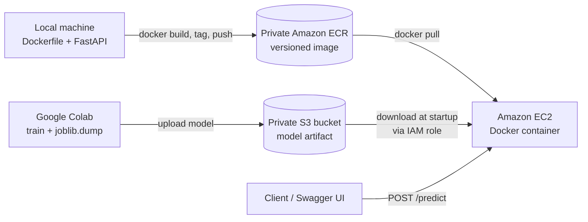

# Student Placement Prediction API: ML Deployment on AWS

An end-to-end machine learning deployment project. A Logistic Regression model predicts whether a student will be placed. It is served through a **FastAPI** REST API, packaged with **Docker**, stored in **Amazon ECR**, and run on **Amazon EC2**. The trained model is kept in a private **Amazon S3** bucket, and access is controlled with **IAM roles and least-privilege policies**.

The aim of this project was to learn the full path from a trained model to a running cloud service, not just to train a model in a notebook.

## Architecture



There are two independent data paths:

- **Deployment path:** local Docker, then ECR, then EC2.
- **Model-loading path:** the application on EC2 downloads the model from S3 at startup and keeps it in memory.

## Tech stack

| Area | Tools |
| --- | --- |
| ML | Python, scikit-learn (Logistic Regression, `StandardScaler`, `OneHotEncoder`, Pipeline), pandas, joblib |
| API | FastAPI, Pydantic, Uvicorn |
| Containers | Docker |
| Cloud | AWS EC2, S3, ECR, IAM, Security Groups |
| AWS SDK | Boto3 |

## The model

- **Task:** binary classification (`placement`: Yes / No)
- **Features:** `iq`, `city`, `percentage`
- **Preprocessing:** `StandardScaler` for numeric features and `OneHotEncoder` for `city`, wrapped in a scikit-learn pipeline so training and prediction use the same transformations
- **Test-set results:** about 80% accuracy and 0.841 ROC-AUC

> These figures come from a small learning dataset and measure performance on the held-out test set only. They are not a guarantee of real-world placement accuracy.

## API endpoints

| Method | Endpoint | Description |
| --- | --- | --- |
| GET | `/` | Basic API information |
| GET | `/health` | Service status, whether the model is loaded, and the model version |
| POST | `/predict` | Returns the predicted placement and class probabilities |

**Request**

```json
{
  "iq": 120,
  "city": "Pune",
  "percentage": 85.5
}
```

**Response** (illustrative; actual values depend on the model)

```json
{
  "placement": "Yes",
  "probability_no": 0.18,
  "probability_yes": 0.82
}
```

Request bodies are validated by Pydantic, and interactive docs are available at `/docs` (Swagger UI).

## Project structure

```text
.
├── main.py                        # API that loads the model from a local file
├── main_aws.py                    # API that downloads the model from S3 at startup
├── student_placement_model.joblib # trained pipeline (used by main.py)
├── Dockerfile
├── requirements.txt
├── .env.example                   # configuration template (copy to .env)
├── .dockerignore
└── .gitignore
```

## Run locally

```bash
python -m venv venv
source venv/bin/activate        # Windows: venv\Scripts\activate
pip install -r requirements.txt

# Local model file version
uvicorn main:app --reload
```

For the S3-backed version, copy `.env.example` to `.env`, fill in your values, and run:

```bash
uvicorn main_aws:app --reload
```

Open http://127.0.0.1:8000/docs to try the API.

## Run with Docker

```bash
docker build -t student-placement-api:v1 .

docker run --rm --name student-placement-api -p 8000:8000 --env-file .env student-placement-api:v1
```

The image deliberately contains **no secrets and no model file**. Configuration is passed at runtime and the model is fetched from S3.

## Deploy to AWS

1. **S3:** create a private bucket (Block Public Access on, encryption and versioning enabled) and upload the model to a key such as `models/student-placement/v1/student_placement_model.joblib`.
2. **ECR:** create a private repository, then authenticate, tag, and push:

   ```bash
   aws ecr get-login-password --region <region> | docker login --username AWS --password-stdin <account-id>.dkr.ecr.<region>.amazonaws.com
   docker tag student-placement-api:v1 <account-id>.dkr.ecr.<region>.amazonaws.com/student-placement-api:v1
   docker push <account-id>.dkr.ecr.<region>.amazonaws.com/student-placement-api:v1
   ```

3. **IAM:** create a role for EC2 and attach:
   - `AmazonEC2ContainerRegistryReadOnly` to pull the image
   - a custom read-only S3 policy scoped to the single model object (below)
4. **EC2:** launch an Amazon Linux 2023 instance with the role attached, install Docker, authenticate to ECR, and pull the image.
5. **Run the container:**

   ```bash
   sudo docker run -d \
     --name student-placement-api \
     --restart unless-stopped \
     -p 8000:8000 \
     -e AWS_DEFAULT_REGION=<region> \
     -e S3_BUCKET=<your-bucket-name> \
     -e S3_KEY=models/student-placement/v1/student_placement_model.joblib \
     <account-id>.dkr.ecr.<region>.amazonaws.com/student-placement-api:v1
   ```

6. **Network:** in the security group, allow TCP 8000 (and SSH on 22) **only from your own IP** while testing.

### Least-privilege S3 policy for the EC2 role

```json
{
  "Version": "2012-10-17",
  "Statement": [
    {
      "Effect": "Allow",
      "Action": "s3:GetObject",
      "Resource": "arn:aws:s3:::<your-bucket-name>/models/student-placement/v1/student_placement_model.joblib"
    }
  ]
}
```

## Security decisions

- No credentials in code, in the Docker image, or in the repository (`.env` is git-ignored and docker-ignored).
- On EC2 the application uses an **IAM role with temporary credentials**, so no long-lived access keys are stored on the server.
- Permissions follow **least privilege**: the instance can read one model object and pull images, but cannot administer IAM, create buckets, or push images.
- The S3 bucket is private, encrypted, and versioned.
- Security-group rules are not API authentication. For a production service I would add HTTPS, authentication, and a proper network design.

## What I learned

- Training a model and serving it reliably are separate problems.
- A Docker image and a running container are different things, and the Docker client talks to a background daemon.
- ECR distributes the application image, while S3 stores the model artifact. They solve different problems.
- A container can be healthy and still unreachable until the port is published in Docker **and** allowed in the security group.
- Separating configuration (which model to load) from credentials (who may load it) makes the same code run locally and in the cloud.

## Possible improvements

- Add API authentication and HTTPS
- CI/CD pipeline (GitHub Actions) to build and push the image
- Model versioning and a rollback strategy
- Structured logging and monitoring
- Automated tests for the API

## Author

**Anand Sant**, GenAI Engineer
[LinkedIn](https://www.linkedin.com/in/anandsant1212/) | [GitHub](https://github.com/anandsant12)
